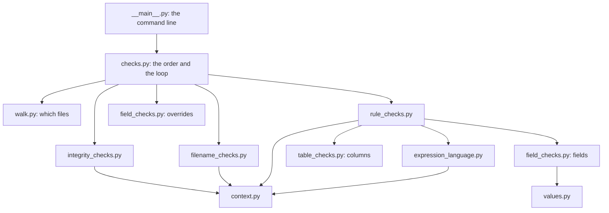
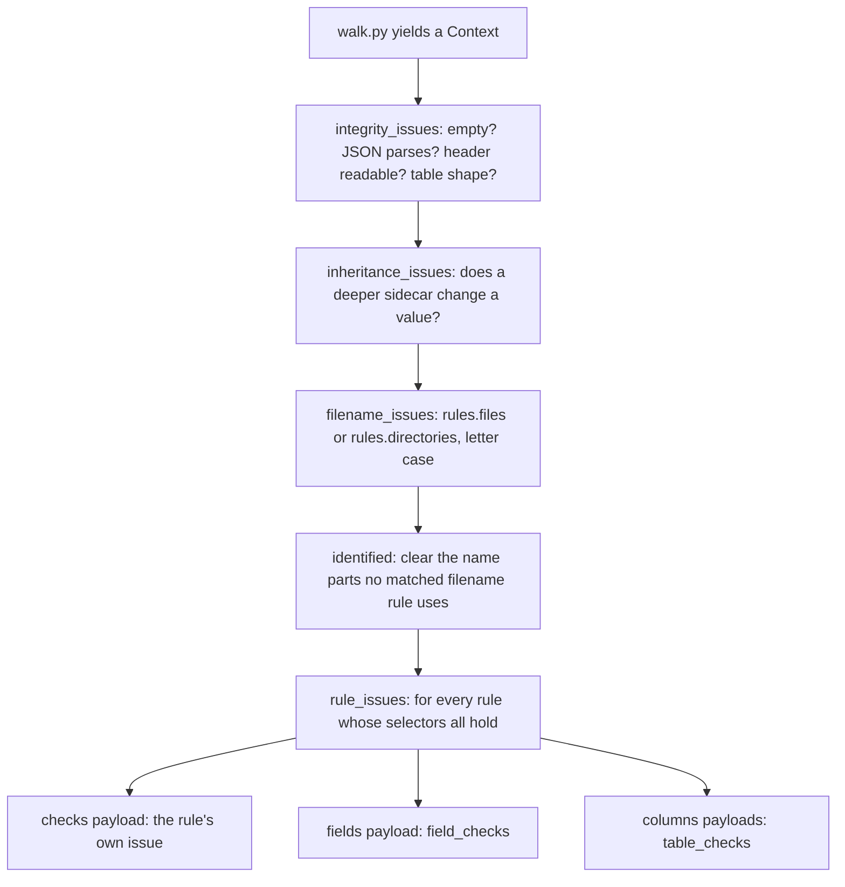

# How python-validator checks a dataset

This describes the full validation layer: what each module is for, how one file is
checked from start to finish, which findings it can produce, how it compares with the
reference validator (bids-validator, written in TypeScript and run with Deno), and every
place where the two differ on purpose.

It covers filename and folder checks, file-integrity checks, and every rule the BIDS
schema writes with selectors: `rules.checks`, the JSON field rules (`rules.sidecars`,
`rules.json`, `rules.dataset_metadata`) and the table rules (`rules.tabular_data`). Rules
that need associated files (the link from a scan to its events file, issue #82), HED, and
OME/TIFF metadata are held back; section 9 lists them.

Contents:

1. [The layout](#1-the-layout)
2. [One file, start to finish](#2-one-file-start-to-finish)
3. [Findings and where their codes come from](#3-findings-and-where-their-codes-come-from)
4. [Which files and folders are visited](#4-which-files-and-folders-are-visited)
5. [Names and places](#5-names-and-places)
6. [Reading files](#6-reading-files)
7. [The schema's rules](#7-the-schemas-rules)
8. [Changes to the expression language and the context](#8-changes-to-the-expression-language-and-the-context)
9. [Comparison with the reference validator](#9-comparison-with-the-reference-validator)
10. [Defects found in other projects](#10-defects-found-in-other-projects)
11. [Adding a check](#11-adding-a-check)
12. [Tests](#12-tests)
13. [Module reference](#13-module-reference)

---

## 1. The layout

The code is grouped by HOW a check works, not by what it looks at. Names and places are
checked against lookup tables (`rules.files`, `rules.directories`); everything else the
schema says about a file is a rule with selectors, run by one engine that hands each
rule's payload to the module that knows it. That is the reference validator's own
structure (`applyRules.ts`).

| Module | Question it answers | Reference (bids-validator) |
|---|---|---|
| `issues.py` | What is a finding? Which codes exist? | `issues/list.ts`, `issues/datasetIssues.ts` |
| `walk.py` | Which files and folders are visited? | `schema/walk.ts`, `files/ignore.ts`, `validators/bids.ts` |
| `filename_checks.py` | Is the name, and the place, legal? | `validators/filenameIdentify.ts`, `filenameValidate.ts`, `filenameCase.ts` |
| `integrity_checks.py` | Can the file be read at all? | `validators/internal/emptyFile.ts`, the loaders in `files/` |
| `rule_checks.py` | Which schema rules apply to the file, and do their `checks` hold? | `schema/applyRules.ts` |
| `field_checks.py` | Are the required JSON fields there, with valid values? | `evalJsonCheck` in `applyRules.ts`, `loadSidecar` in `schema/context.ts` |
| `table_checks.py` | Are a table's columns right? | `schema/tables.ts` |
| `values.py` | Does one value satisfy its schema definition? | `validators/json.ts` (ajv) |
| `checks.py` | Which checks run, in what order? | `validators/bids.ts` |
| `context.py` | What is known about one file? (upstream) | `schema/context.ts` |
| `expression_language.py` | What does a schema expression evaluate to? (upstream) | `schema/expressionLanguage.ts` |



Every check module builds its findings with `issues.py` and reads files only through
`context.py`.

## 2. One file, start to finish

`checks.collect_issues(tree, schema)` runs the per-dataset checks once, then walks the
dataset and gives every visited file and folder to each per-file check, in this order:

```python
PER_DATASET_CHECKS = (dataset_integrity_issues,)
PER_FILE_CHECKS = (integrity_issues, inheritance_issues, filename_issues, rule_issues)
```

That is the reference validator's order: problems reading a file first (its context
loaders report them), then the name, then the schema rules.



A file's `Context` is built once and shared by every check, so whatever it loads (the
merged sidecar, the NIfTI header, the table) is loaded once.

From Python:

```python
from bidsschematools.schema import load_schema
from bids_validator.checks import collect_issues
from bids_validator.types.files import FileTree

issues = collect_issues(FileTree.read_from_filesystem('my_dataset'), load_schema())
for issue in issues:
    print(issue.severity.value, issue.code, issue.location, issue.rule)
```

`collect_issues(..., checks=(filename_issues,), dataset_checks=())` runs one family
alone.

From the command line (`bids-validator my_dataset`), on a small dataset with a few
deliberate problems (recommended-field warnings left out):

```console
warning: README_FILE_SMALL: README
    The recommended file '/README' is very small. Please consider expanding it ...
warning: TOO_FEW_AUTHORS: dataset_description.json
    The 'Authors' field of 'dataset_description.json' should contain an array of ...
error: TSV_VALUE_INCORRECT_TYPE: participants.tsv
    line 2: 'thirty'
error: T1W_FILE_WITH_TOO_MANY_DIMENSIONS: sub-01/anat/sub-01_T1w.nii.gz
    _T1w.nii[.gz] files must have exactly three dimensions.
error: EMPTY_FILE: sub-01/func/sub-01_task-rest_bold.nii.gz
    Empty files not allowed.
error: NIFTI_HEADER_UNREADABLE: sub-01/func/sub-01_task-rest_bold.nii.gz
    We were unable to parse header data from this NIfTI file. ...
error: SIDECAR_KEY_REQUIRED: sub-01/func/sub-01_task-rest_bold.nii.gz
    the required field 'TaskName' is missing
error: JSON_SCHEMA_VALIDATION_ERROR: sub-01/func/sub-01_task-rest_bold.json
    RepetitionTime must be > 0

6 error(s), 61 warning(s)
```

The reference validator reports the same findings on this dataset, except one
`JSON_KEY_RECOMMENDED` (section 9.3, item 2). The exit code is 1 when there is an
error, 0 otherwise; `-v` adds the schema rule of each finding.

## 3. Findings and where their codes come from

A finding is an `Issue`: `code`, `severity` (`error` or `warning`), `location` (the
dataset-relative path, without a leading `/`; `None` for a dataset-level finding),
`message`, `sub_code` (a field, column or entity name) and `rule` (the schema rule's
dotted path). A run returns a `DatasetIssues`.

A code's level and default message come from one of two places:

* **The schema** defines some issues itself: every `rules.checks` rule has an `issue`
  block, some field requirements have one, and `rules.errors` lists general ones
  (`NOT_INCLUDED`, `EMPTY_FILE`, `JSON_INVALID`, `NIFTI_HEADER_UNREADABLE`,
  `INVALID_JSON_ENCODING`, `JSON_SCHEMA_VALIDATION_ERROR`).
* **The reference validator's catalog** (`src/issues/list.ts`) defines the rest
  (`MISSING_DATATYPE`, `TSV_COLUMN_MISSING`, `SIDECAR_KEY_REQUIRED` ...).
  `issues.REFERENCE_CODES` mirrors the 39 this package can emit, with their severity
  and reason.

Two functions build every finding, so no check repeats that lookup:

* `schema_issue(definition, location=..., ...)` builds a finding from a schema issue
  block (and takes a `severity` when the block leaves its level out, as a field's issue
  does: the field's requirement level decides).
* `coded_issue(schema, code, location=..., ...)` builds a finding for a known code,
  preferring the schema's `rules.errors` definition when there is one. An unknown code
  raises `KeyError`, so a typo fails a test instead of reporting nonsense.

## 4. Which files and folders are visited

`walk.iter_contexts(dataset)` yields a context for every file AND every folder that is
not ignored, each folder's files before its subfolders, as in the reference.

| What | Treatment |
|---|---|
| `/sourcedata/`, `/derivatives/`, `/code/`, `/stimuli/`, `/log/`, `/doc/` | ignored: the reference's default list, anchored at the dataset root (`DEFAULT_IGNORES`); a deeper `sub-01/log/` is checked |
| hidden files and folders (`.git`, `.DS_Store`, `.datalad`) | ignored at every level (`PRUNED`) |
| whatever `.bidsignore` lists | ignored; `.bidsignore` itself is visited and exempt from `NOT_INCLUDED` |
| a directory recording: entities, a suffix and an extension the schema spells with `/` (`.ds/`, `.mefd/`, `.ome.zarr/`, and a bare `/`) | visited as ONE file, not walked into |
| an opaque folder (`rules.directories`: `docs`, `logs` ...) | visited, not walked into |
| a `derivatives` folder in a raw dataset, at any depth | skipped: a separate dataset with separate rules |
| any other folder | visited, then walked into |

The bare `/` extension (`objects.extensions.Directory`) means a folder named like a file,
for example `sub-16/log/20200910-165242_99fc.../` in an fMRIPrep output, is one unit:
the reference reports it, and does not look inside.

`walk.is_directory(context)` tells a plain folder from a file or a recording.

## 5. Names and places

`filename_checks.filename_issues(context)` checks a file against `rules.files` and a
folder against `rules.directories`. Nothing is opened.

A FOLDER must match a folder rule by exact name (`phenotype`), by entity (a name starting
with `sub-` or `ses-`) or by value (any datatype), as in the reference; otherwise it is
`NOT_INCLUDED`. Like the reference, the depth is not checked.

A FILE is identified (which rules match it by path, stem or suffix; derivative rules only
in a derivative dataset), narrowed to the best candidates, then checked:

| Code | When |
|---|---|
| `NOT_INCLUDED` | no rule matches |
| `ENTITY_WITH_NO_LABEL` | `acq-` (empty) or `foo` (no hyphen) in a name whose rule uses entities |
| `INVALID_ENTITY_LABEL` | a label breaks its entity's format (`acq-a!b`) |
| `MISSING_REQUIRED_ENTITY` | a required entity is missing (not checked for files at the root) |
| `ENTITY_NOT_IN_RULE` | an entity the rule does not allow |
| `MISSING_DATATYPE` | a data file in no datatype folder (`sub-01/sub-01_T1w.nii.gz`) |
| `DATATYPE_MISMATCH` | a data file in another datatype's folder |
| `EXTENSION_MISMATCH` | an extension the rule does not allow |
| `INVALID_LOCATION` | a valid name under the wrong `sub-`/`ses-` folders |
| `FILENAME_MISMATCH` | entities out of the schema's order or duplicated |
| `ALL_FILENAME_RULES_HAVE_ISSUES` | several rules match and none fits cleanly |
| `CASE_COLLISION` | another file in the folder differs only by letter case |

`MISSING_DATATYPE` and `DATATYPE_MISMATCH` never apply to `.json`, `.tsv`, `.bvec` and
`.bval` (`SIDECAR_EXTENSIONS`): those may sit above the data they describe. A sidecar lost
in a bogus folder (`sub-01/ses-1/foo/x.json`) is still caught, through the folder's own
`NOT_INCLUDED`. `MISSING_DATATYPE` is the reference's code since 2026-10-08 (commit
`f0cc83fb`, not yet in a release); before it, this case was reported as
`INVALID_LOCATION` here and missed by the reference.

`filename_checks.identified(context)` returns the context as the schema rules see it once
the name is identified: a name part that no matched rule uses is cleared (the reference's
`cleanContext`). A file that matched no rule has no entities, suffix or extension for
the rules to read, so `.bidsignore` or an unrecognised folder is not held to the sidecar
rules of whatever its name resembles. It is a read-only view: nothing is copied.

## 6. Reading files

`integrity_checks.integrity_issues(context)` reports a file that cannot be read the way
its type needs. It asks the context's own loaders (so each file is read once) and turns
the coded `ValidationError` they raise into a finding:

| Code | When |
|---|---|
| `EMPTY_FILE` | 0 bytes; for a directory recording, its files add up to 0 (hidden files not counted) |
| `INVALID_JSON_ENCODING` | not UTF-8, or starts with a byte order mark (JSON forbids one) |
| `JSON_INVALID` | does not parse |
| `JSON_NOT_AN_OBJECT` | parses, but is not an object |
| `NIFTI_HEADER_UNREADABLE` | the NIfTI header cannot be read (an empty image gets this AND `EMPTY_FILE`, as in the reference) |
| `TSV_COLUMN_HEADER_DUPLICATE` | two columns with one name |
| `TSV_EMPTY_LINE` | an empty line that is not the last |
| `TSV_EQUAL_ROWS` | a row with a different number of cells than headers |
| `INVALID_GZIP` | a headerless `.tsv.gz` that does not decompress |
| `MULTIPLE_INHERITABLE_FILES` | two sidecars at one level apply equally well (reported on the first) |

`dataset_integrity_issues(dataset)` reports `MISSING_DATASET_DESCRIPTION`.

When a load fails, the context gives the rules an empty value (no header, no columns, an
empty JSON object), so a broken file is reported here once, not again as a failed check
in every rule that reads it. Tables are read up to `context.TSV_MAX_ROWS` rows (1000, the
reference's `--max-rows` default).

## 7. The schema's rules

### 7.1 How a rule is applied

Every rule with selectors has the same shape: when every selector holds, each payload
says what must then be true.

```yaml
ReadmeFileSmall:            # rules.checks.general.ReadmeFileSmall
  issue: {code: README_FILE_SMALL, level: warning, message: "The recommended file ..."}
  selectors: [match(path, '^/README')]
  checks: [size > 150]
```

`rule_checks.rule_issues(context)` evaluates each rule's selectors (stopping at the
first that is not true) and hands each payload to its handler, in the rule's own order,
from `rule_checks.PAYLOADS`:

| Payload | Handler | Rule groups |
|---|---|---|
| `checks` | `rule_checks.check_issues` | `rules.checks` |
| `columns`, `initial_columns`, `index_columns` | `table_checks.column_issues`, `initial_column_issues`, `index_column_issues` | `rules.tabular_data` |
| `fields` | `field_checks.field_issues` | `rules.sidecars`, `rules.json`, `rules.dataset_metadata` |

`null` follows the schema's documentation (bids-specification `src/schema/README.md`,
"The special value null"): "if an expression (selector or check) evaluates to null, the
null will be interpreted equivalent to false. That is, a null selector will not apply the
current rule, and a null check will fail." An expression that raises counts as `null`, as
in the reference (`_evalCheck` in `applyRules.ts`); it is logged at `DEBUG` level. A
failed `checks` rule reports its own `issue`, with `{...}` placeholders in the message
filled in for the file; a rule without a complete issue reports `CHECK_ERROR`.

### 7.2 Which rules run

`rule_checks.NOT_ENABLED_YET = ('associations', 'ome', 'tiff')`: the parts of the context
not built yet. `names_read(rule)` parses a rule's expressions and lists the context names
it reads; a rule reading a held-back name is skipped, because evaluating it against an
empty placeholder would report problems that are not there ("a task scan needs an events
file" would fire on every task scan). With the schema of bidsschematools 1.2.4 (BIDS
1.11.1):

| Group | Rules | Run |
|---|---|---|
| `rules.checks` | 129 | 82 |
| `rules.sidecars` | 174 | 174 |
| `rules.json` | 35 | 35 |
| `rules.dataset_metadata` | 6 | 6 |
| `rules.tabular_data` | 28 | 28 |

(`rules.errors` and the derivative `rules.files` entries also carry selectors but no
payload, so they are skipped in the per-file loop.)

### 7.3 JSON fields

`field_checks.field_issues` handles the `fields` payload:

* `rules.sidecars` describe a data file's SIDECAR (its JSON files merged by the
  inheritance principle, `context.sidecar`); a missing field is `SIDECAR_KEY_REQUIRED`
  (error) or `SIDECAR_KEY_RECOMMENDED` (warning), on the data file. A `.json` file, and
  `README`-like files, have no sidecar, so these rules skip them.
* `rules.json` and `rules.dataset_metadata` describe one JSON file (`context.json`); a
  missing field is `JSON_KEY_REQUIRED` or `JSON_KEY_RECOMMENDED`.
* A field may carry its own issue (`NO_AUTHORS`, `B0_FIELD_IDENTIFIER_RECOMMENDED` ...),
  used instead, with the field's level as its severity.
* A level addendum "required if `Key` is `Value`" raises the level when the sidecar's
  `Key` is that string. (In the current schema no addendum can take effect: the rule's own
  selectors exclude the triggering value, and for `rules.json` the reference reads the
  addendum's key from the sidecar, which a JSON file does not have. Kept for parity.)
* In a derivative dataset, fields are optional unless the rule selects
  `dataset.dataset_description.DatasetType == "derivative"`.
* A present field's value is checked against its `objects.metadata` definition
  (`values.value_errors`); a wrong value is `JSON_SCHEMA_VALIDATION_ERROR`, on the JSON
  file that holds the key (`context.sidecar_origins`), and for a sidecar key once per
  dataset, not once per data file inheriting it.

`field_checks.inheritance_issues` warns `SIDECAR_FIELD_OVERRIDE` where a deeper JSON file
gives a field a different value than a JSON file above it (on the deeper file, once per
data file inheriting both). Values are compared by content.

`values.value_errors` implements the JSON Schema the metadata definitions use, with the
behaviour of ajv as the reference configures it: the first failing keyword only (in
ajv's order: `type`, then `enum` and `anyOf`, then the number, string, array and object
keywords), every branch's first error plus `must match a schema in anyOf` when no
alternative fits, ajv's messages (`must be > 0`), and formats SEARCHED rather than
matched (ajv's `RegExp.test`), so a format pattern without `^`/`$` only needs to occur
somewhere in the value.

### 7.4 Tables

`table_checks` handles the three table payloads, following `schema/tables.ts`:

| Code | When |
|---|---|
| `TSV_COLUMN_MISSING` | a required column is absent (for an initial column, reported by the order check) |
| `TSV_COLUMN_ORDER_INCORRECT` | an initial column is not where the rule puts it |
| `TSV_ADDITIONAL_COLUMNS_NOT_ALLOWED` | a column the rule does not list, where none are allowed |
| `TSV_ADDITIONAL_COLUMNS_MUST_DEFINE` | the same, where extra columns must be defined in the sidecar and this one is not |
| `TSV_ADDITIONAL_COLUMNS_UNDEFINED` | the same, where they are allowed but this one is not defined (warning) |
| `TSV_COLUMN_TYPE_REDEFINED` | the sidecar contradicts the schema's definition of a column (on the sidecar) |
| `TSV_VALUE_INCORRECT_TYPE` | the first value of a column that breaks its type, levels or bounds |
| `TSV_PSEUDO_AGE_DEPRECATED` | `89+` in an `age` column (once) |
| `TSV_INDEX_VALUE_NOT_UNIQUE` | two rows share the index columns' values |

A column's type comes from the schema (`objects.columns`), refined by the sidecar's own
definition of the column (`Format`, `Levels`, `Units`, `Minimum`, `Maximum`), which may
narrow it but not contradict it. `n/a` is always accepted. Column names containing a dot
(`key_resp.rt`, as PsychoPy writes them) work: see section 8.2.

## 8. Changes to the expression language and the context

Both modules are upstream (the expression language is Dan Brady's, PR #71; the context
is Chris Markiewicz's and Dan's). Every change keeps their structure and follows the
schema's documentation or, where it is silent, the reference implementation.

### 8.1 The expression language

The schema's 77 expression test vectors all passed before these changes. They never
compare numbers, never read values loaded from real files, and never test the truth of
an empty array; the schema's rules do all three.

| Behaviour | Before | After | Rules affected |
|---|---|---|---|
| `<`, `<=`, `>`, `>=` | `KeyError` | numbers as numbers, two strings as text, `null` gives `false` | 30 of 129 `rules.checks` (with `**`) |
| `**` | `KeyError` | power | `func.RepetitionTimeMismatch`, `micr.PixelSizeInconsistent` |
| `null + 1`, `null * 2` | `TypeError` | `null` | any arithmetic on a missing field |
| `1 + "a"` | `TypeError` | `"1a"` | |
| `-3 % 2`, `1 / 0` | `1`, `ZeroDivisionError` | `-1`, infinity | |
| truth of `[]`, `{}` | false (Python's rule) | true (the language's rule) | every `!`, `&&`, `\|\|`, selector and check |
| `type("abc")`, `type()` of numpy arrays, tuples, header objects | `"null"` | `"string"`, `"array"`, `"array"`, `"object"` | 29 rules gated on `type(...) != "null"`, which never ran |
| `[1, 2][5]`, `[1, 2][-1]` | `IndexError`, `2` | `null`, `null` | |
| `"x" in record` (an object) | `TypeError` | field present and not null | |
| `".git" in namespace` | inserted a key into the Namespace | tests the keys only | |
| `min`/`max` of TSV cells (`["0.5", "n/a"]`) | `ValueError` | numbers, `n/a` skipped; infinity if none | `events.*` onset checks |
| `length(3)`, `sorted(null)`, `count(null, 1)` | `TypeError`/`AttributeError` | `null` | |
| `intersects("rad", [...])` | `false` (compared characters) | `["rad"]` | |
| `match(42, "4")`, an invalid pattern | `TypeError`, `re.error` | `true`, `null` | |
| an unknown name | `AttributeError` | `null` | |
| an unknown function (`len`) | `'NoneType' object is not callable` | `TypeError: Unknown function 'len'` | `anat.PDT2Echos` (a schema defect) |

New helpers: `truthy` (the language's truth test), `normalize` (numpy and tuples to plain
values), `as_number`, `numeric_values` (replaces `filter_strs`, which dropped numeric
text), and a cached `parse`. `LookupProxy` reads a context attribute once instead of
twice. Measured with the 48 new test vectors: 12 right before, 48 after.

### 8.2 The context

| Change | Why |
|---|---|
| `ValidationError(code, message, line=, location=)` | the upstream TODO ("Add issue structure"): a loader's error carries the code it is reported under |
| `Record`, a `dict` with attribute access, holds file contents (JSON, columns) | a bidsschematools `Namespace` reads `"key_resp.rt"` as a path and cannot even list a mapping holding such a key |
| `load_json` raises `INVALID_JSON_ENCODING`, `JSON_INVALID`, `JSON_NOT_AN_OBJECT` | so integrity checks can report them |
| `load_tsv`/`load_tsv_gz` raise `TSV_COLUMN_HEADER_DUPLICATE`, `TSV_EMPTY_LINE`, `TSV_EQUAL_ROWS`, `INVALID_GZIP`; drop a byte order mark; a header with no rows gives empty columns, not none | as the reference; mne-bids writes a byte order mark |
| `Context.read_columns()` (raises) and `Context.columns` (empty on error), up to `TSV_MAX_ROWS` | one place decides how a table is read |
| `Context.sidecar`: cached, empty for a `.json` file, `RepetitionTime` rounded to milliseconds, a broken sidecar skipped rather than fatal | as the reference's `loadSidecar` |
| `walk_back` prefers a candidate with every entity of the source before calling it ambiguous | as the reference's `walkBack` |
| `sidecar_origins(file)` | where each sidecar key comes from, for value findings |
| `Context.json` empty and `Context.nifti_header` `None` when unreadable | the rule sees "no value" instead of raising |
| `Dataset.dataset_description` defaults `DatasetType` (`derivative` with `GeneratedBy`, else `raw`) and is empty when missing | rules selecting `DatasetType == "raw"` otherwise skip every dataset leaving it out |
| `Dataset.checked_sidecar_values` | so a wrong value in a shared sidecar is reported once |
| `datatype_to_modality` returns `None` for `phenotype` | it raised `KeyError` |
| `find_datatypes` tests `datatypes.keys()` | `".git" in namespace` inserted a key into the shared, cached schema, and every later context failed |
| `exists()` resolves paths by hand (`tree_contains`) | a leading `/` was never found (so `DUPLICATE_FILES` could not fire) and a `bids::` URI raised |

## 9. Comparison with the reference validator

### 9.1 Method

Both validators were run on the same datasets and their findings compared by
`(code, location)`. Reference: bids-validator 3.0.2 (Deno), schema 1.2.7. This package:
bidsschematools 1.2.4. The scripts are not part of the repository.

### 9.2 Results

**All 84 bids-examples datasets** (at the submodule commit) with a
`dataset_description.json`:

| | Findings |
|---|---|
| reported by both | 141,420 |
| only by the reference | 1,038 |
| only here | 475 |
| crashes | 0 |

Every one of the 1,513 differences has a known cause (9.3).

**A real multimodal dataset** (MRI, fieldmaps, DWI, PET, MEG, EEG, MRS, physiology,
written by BIDS Manager): 50 findings by both, 0 only by the reference, 7 only here (all
explained in 9.3). The reference CRASHES on the full dataset (section 10); the comparison
used a copy without the eye-tracking files.

**One dataset per test case** (59, built from the unit tests): 54 identical; the other 5
are explained in 9.3.

**Speed**: all 84 bids-examples datasets in 32 s here, 32 s for the reference, run one
after the other on the same machine.

### 9.3 Every difference, and why

Only in the reference:

| Code | Count | Why |
|---|---|---|
| `EVENTS_TSV_MISSING`, `*_CHANNEL_COUNT_MISMATCH`, `MISSING_MAGNITUDE1_FILE`, `REQUIRED_COORDSYSTEM` | 984 | rules reading `associations`: held back until issue #82 |
| `HED_ERROR` | 32 | HED validation is not part of this package yet |
| `SIDECAR_WITHOUT_DATAFILE` | 12 | needs to know which JSON files any rule used, which comes with associations |
| `SIDECAR_FIELD_OVERRIDE` | 6 | the reference compares objects with JavaScript's `!==`, by reference, so the same object written at two levels is reported; here it is compared by content |
| `NOT_INCLUDED` on `sub-*/figures/` | 4 | a reference defect: `figures/` is in that dataset's `.bidsignore`, but the reference tests a folder's path without its trailing `/`, so folder-only patterns never match folders |

Only here:

| Code | Count | Why |
|---|---|---|
| `B0_FIELD_SOURCE_RECOMMENDED`, `SIDECAR_KEY_*` for `AnatomicalImage`, `NonlinearGradientCorrection`, `AnatomicalLandmarkCoordinates` | 423 | a reference defect: these rules select on `dataset.datatypes` or `dataset.modalities`, which the reference never fills in the context its rules see, so they can never apply there |
| `JSON_KEY_RECOMMENDED` for `DatasetType` | 51 | a reference defect: it writes its default `DatasetType` into its cached copy of `dataset_description.json`, so the rule checking the file's own content never sees the field missing |
| `MISSING_DATATYPE` | 1 | in the reference's `main` branch, not yet in a release |
| `MRS_NIFTI_CONSISTENCY` | 2 (real dataset) | the reference stops reading a NIfTI header before its extensions, so it never sees the NIfTI-MRS metadata and never runs this rule |
| `DUPLICATE_FILES` | (test cases) | a reference defect: its `exists()` cannot find a path starting with `/`, so this rule can never fire there |
| `SAMPLES_TSV_MISSING` | (test cases) | the `dataset.modalities` defect above |

The reference's 3.0.2 release also still reports `DATATYPE_MISMATCH` for a `.json` in
another datatype's folder; its `main` branch no longer does, and neither does this
package.

## 10. Defects found in other projects

Found while building and comparing; reported here, not fixed (except where this package
needed to work around them).

| Where | Defect |
|---|---|
| bids-validator (reference) | crashes (`Cannot read properties of undefined (reading 'path')`) on an eye-tracking dataset without an associated events file, while filling the placeholder `{associations.events.path}` of an issue message |
| bids-validator | `exists()` never finds a path starting with `/`, so `DUPLICATE_FILES` cannot fire |
| bids-validator | `dataset.datatypes` and `dataset.modalities` are never filled for the rules, so seven rules can never apply: `checks.dataset.SamplesTSVMissing`, `json.meg.MEGCoordsystemAnatomicalMRI`, `sidecars.meg.MEGwithEEG`, `sidecars.mri.PETMRISequenceSpecifics`, `sidecars.mri.MRIAnatomicalLandmarks`, `sidecars.mri.MRIEchoPlanarImagingAndB0FieldSource`, `sidecars.mrs.MRSConditionalAnatomicalImage` |
| bids-validator | the `DatasetType` default is written into the cached `dataset_description.json`, hiding the missing field |
| bids-validator | `.bidsignore` folder patterns (`figures/`) are not applied to the folders themselves |
| bids-validator | `SIDECAR_FIELD_OVERRIDE` compares objects by reference |
| bidsschematools `Namespace` | `".git" in namespace` inserts an empty key (worked around: `.keys()`) |
| bidsschematools `Namespace` | a key with a dot cannot be held at all (worked around: `Record`) |
| BIDS schema `rules.checks.anat.PDT2Echos` | uses `len(...)`, not the language's `length(...)`; the check always fails where it applies |
| BIDS schema `rules.checks.mrs.MRSNiftiConsistency` | compares `SpectrometerFrequency` exactly; the NIfTI-MRS header holds a 32-bit float (`123.26260375976562` against `123.262604`), so it fires on float noise |
| BIDS schema, field level addenda | none can take effect in the current schema (section 7.3) |

## 11. Adding a check

* A new kind of per-file check: write a function `Context -> list[Issue]` in its own
  module, build its findings with `issues.coded_issue` (adding the code to
  `REFERENCE_CODES` if the schema does not define it), and add it to
  `checks.PER_FILE_CHECKS`. Per-dataset: `Dataset -> list[Issue]` in
  `PER_DATASET_CHECKS`.
* A new payload kind in the schema: write a handler `(path, rule, context) -> list[Issue]`
  and add it to `rule_checks.PAYLOADS`.
* When associations exist (#82): remove `'associations'` from
  `rule_checks.NOT_ENABLED_YET`; 45 more `rules.checks` rules then run (two more wait for
  `ome` and `tiff`).

## 12. Tests

| File | Tests | What they pin |
|---|---|---|
| `tests/test_walk.py` | 22 | ignores, `.bidsignore`, recordings, opaque and derivative folders, order, subjects |
| `tests/test_filename_checks.py` | 37 | every filename code, folders, inheritable files, case, `identified`, recordings, derivatives |
| `tests/test_integrity_checks.py` | 21 | every integrity code, readable files staying quiet, sidecar ambiguity |
| `tests/test_rule_checks.py` | 38 | the gate, payload order, null and error semantics, a failing and a passing dataset per sample rule |
| `tests/test_field_checks.py` | 11 | missing fields, a field's own issue, derivatives, addenda, values reported once where written, overrides |
| `tests/test_table_checks.py` | 17 | every table code, `n/a`, levels, bounds, redefinition, dotted column names |
| `tests/test_values.py` | 32 | each JSON Schema keyword with ajv's messages, `anyOf`, format search, JSON equality |
| `tests/test_expression_language.py` | 145 | the schema's 77 vectors, 48 more behaviours, numpy and tuple values |
| `tests/test_context.py` | 41 | upstream's, plus the context changes above |
| `tests/test_checks.py`, `tests/test_main.py`, `tests/test_issues.py` | 4, 8, 11 | the order, one walk equals the families apart, the CLI, the builders |

`tests/helpers.py` holds the small dataset builders they share (`write`, `build`,
`clean_dataset` (a dataset both validators find clean), `nifti`, `gzipped`, `findings`).

643 pass with the bids-examples data (1 skipped: the MRS data needs Git LFS); 614 pass
and 30 skip without it. `ruff check`, `ruff format`, `codespell` and `mypy --python-version
3.13 src tests` are clean.

## 13. Module reference

| Module | Public names |
|---|---|
| `checks` | `collect_issues(tree, schema, *, checks, dataset_checks)`, `PER_FILE_CHECKS`, `PER_DATASET_CHECKS` |
| `issues` | `Issue`, `Severity` (`from_level`), `DatasetIssues`, `REFERENCE_CODES`, `schema_issue`, `coded_issue` |
| `walk` | `iter_contexts(dataset, ignore=None)`, `build_ignore(tree)`, `is_directory(context)`, `DEFAULT_IGNORES`, `PRUNED`, `DERIVATIVES_DIR` |
| `filename_checks` | `filename_issues(context)`, `identified(context)`, `SIDECAR_EXTENSIONS` |
| `integrity_checks` | `integrity_issues(context)`, `dataset_integrity_issues(dataset)` |
| `rule_checks` | `rule_issues(context)`, `apply_rule(path, rule, context)`, `check_issues`, `runnable_rules(schema)`, `names_read(rule)`, `evaluate(expression, context, path)`, `PAYLOADS`, `NOT_ENABLED_YET` |
| `field_checks` | `field_issues(path, rule, context)`, `inheritance_issues(context)` |
| `table_checks` | `column_issues`, `initial_column_issues`, `index_column_issues` (all `(path, rule, context)`) |
| `values` | `value_errors(value, definition, formats)`, `json_equal(a, b)` |
| `context` (new or changed) | `ValidationError`, `Record`, `TSV_MAX_ROWS`, `load_json`, `load_tsv`, `load_tsv_gz`, `sidecar_origins`, `tree_contains`, `Context.read_columns`, `Context.columns`, `Context.sidecar`, `Context.json`, `Context.nifti_header`, `Dataset.dataset_description`, `Dataset.checked_sidecar_values` |
| `expression_language` (new or changed) | `truthy`, `normalize`, `as_number`, `numeric_values`, `parse`, `bin_ops`, `right_ops`, `evaluate` |
